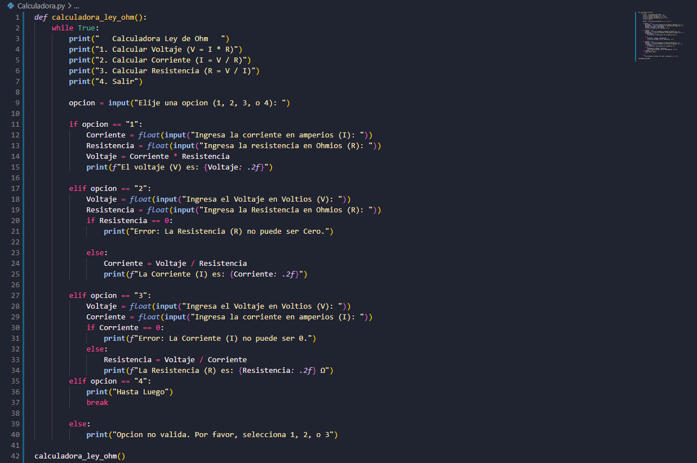

# Calculadora Ley de Ohm (v1, consola)

Esta es la primera versión de mi calculadora de la ley de Ohm, que funciona en la consola. Escrita totalmente con Python.

Eliges qué quieres calcular (voltaje, corriente o resistencia), ingresas los valores que conoces, y el programa hace el resto.

Existe una versión 2 con interfaz gráfica: [Calculadora Ley de Ohm v2](https://github.com/benjaleiva0807/Calculadora-ley-de-ohm-v2).

## Características

- Calcula el voltaje (V = I × R), la corriente (I = V / R) y la resistencia (R = V / I)
- Menú cíclico: permite hacer varios cálculos seguidos sin reiniciar el programa
- Opción para salir del programa
- Protección en contra de la división por 0
- Aviso cuando se elige una opción no válida

## Captura de pantalla

## Cómo ejecutar

1. Instala Python 3
2. Descarga el repositorio
3. Corre: `python Calculadora.py`

No se requieren librerías extras.

## Qué aprendí

- Uso de `input()` y `float()` para pedir datos y convertirlos en números
- Uso de `if / elif / else` para armar un menú
- Uso de una función (`def`) para ordenar el código
- Uso de `while True` y `break` para mantener cíclico un programa
- Uso de f-strings para mostrar resultados con 2 decimales

## Limitaciones conocidas

- Si se escriben letras en vez de números, el programa se cierra con un error. Lo corregí en la [versión 2](https://github.com/benjaleiva0807/Calculadora-ley-de-ohm-v2).
- Solo funciona en la consola, sin interfaz gráfica.

## Autor

Benjamín Leiva (Alex) - Estudiante de Ingeniería en Automatización y Control Industrial, y autodidacta de programación.
